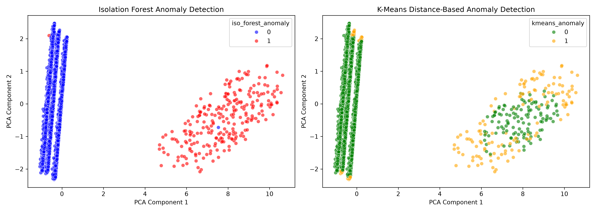

<<<<<<< HEAD
# Unusual Mobile Money Transactions Detection

A coursework portfolio project focused on detecting anomalous and potentially fraudulent mobile money transactions using unsupervised machine learning.

**Project Serial Number:** 9  
**Coursework Submission Deadline:** 9th October 2026  

---

## Project Summary
Mobile money platforms generate large volumes of transactional data, often without a reliable labeled fraud dataset. This project addresses that challenge by applying unsupervised learning to detect outliers and unusual behavior patterns in transaction data.

The system combines:
- **Isolation Forest** for identifying rare, isolated data points in high-dimensional space
- **K-Means Clustering** for segmenting normal behavioral patterns and measuring distance-based anomalies
- **PCA** for visual interpretation of transaction clusters and outliers

The goal is to support early fraud detection by surfacing suspicious transactions such as unusually large transfers, unrealistic balance changes, or unusual withdrawal patterns.

---

## Live Portfolio
- GitHub Pages: [Live Portfolio Website](https://Tessy-123.github.io/unusual-mobile-money-transactions/)
- GitHub Repository: [Tessy-123/unusual-mobile-money-transactions](https://github.com/Tessy-123/unusual-mobile-money-transactions)

---

## Problem Statement
Mobile money fraud often involves complex, non-linear behavior that is difficult to detect using traditional rule-based systems. Since labels may be incomplete or unavailable, unsupervised learning provides a practical way to flag unusual transaction behavior based on deviations from typical patterns.

This project demonstrates how such methods can be used to detect unusual transactions without requiring a pre-labeled fraud dataset.

---

## Methodology

### 1. Data Preparation
The project begins with synthetic mobile money transaction data containing attributes such as:
- transaction type
- transaction amount
- sender balance before transaction
- sender balance after transaction
- balance change

The categorical transaction type field was transformed using **One-Hot Encoding**, and numerical features were standardized using **StandardScaler** to reduce scale imbalance.

### 2. Model 1: Isolation Forest
Isolation Forest is a tree-based anomaly detection method that isolates outliers by repeatedly splitting data on random feature thresholds. Normal observations usually require more splits to isolate, while anomalous ones are separated quickly.

The model was configured with a contamination rate of **5%**.

### 3. Model 2: K-Means Distance-Based Detection
K-Means clustering partitions transactions into a fixed number of clusters, and each transaction is scored by its distance from its assigned centroid. The highest-distance observations are treated as anomalies, using the top **5%** of distances as the anomaly threshold.

### 4. Dimensionality Reduction & Visualization
Principal Component Analysis (PCA) was used to reduce the feature space to 2 dimensions for visualizing clustering and anomaly regions in a more interpretable form.

---

## Evaluation and Interpretation
The model output was assessed by comparing the patterns of anomalies flagged by:
- Isolation Forest
- K-Means distance scoring

The two methods were used together to identify transactions that exhibited high-risk characteristics such as:
- unusually large transfers
- abnormal balance increases or decreases
- transactions inconsistent with normal customer behavior

---

## Repository Structure

```text
unusual-mobile-money-transactions/
├── index.html               # Homepage for the project portfolio
├── methodology.html         # Methodology and technical workflow page
├── insights.html            # Findings, visualizations, and outputs page
├── styles.css               # Global styling and layout
├── anomaly_detection.py     # Core ML pipeline and synthetic dataset generation
├── anomaly_detection_results.png
├── mobile_money_anomalies_output.csv
├── iso_forest_model.pkl     # Trained Isolation Forest model
├── kmeans_model.pkl         # Trained K-Means model
├── scaler.pkl               # Fitted StandardScaler
├── README.md                # Project documentation
├── .gitignore               # Git exclusions
└── LICENSE                  # Optional project license
```

---

## Results and Outputs
The project produces the following outputs:
- anomaly detection visualization plot
- processed transaction dataset with anomaly labels
- trained machine learning artifacts
- interactive project portfolio website

### Screenshot


---

## How to Run

### 1. Install required dependencies
```bash
pip install numpy pandas scikit-learn matplotlib seaborn joblib
```

### 2. Execute the pipeline
```bash
python anomaly_detection.py
```

This script will generate the anomaly visualization, save the processed CSV results, and persist the trained model files.

---

## Key Findings
- Isolation Forest successfully identifies rare or extreme transaction behaviors in a high-dimensional feature space.
- K-Means provides a more interpretable segmentation of normal transaction patterns.
- Combining both techniques yields a stronger anomaly detection workflow than using either method alone.

---

## Conclusion
This project demonstrates a robust, unsupervised machine learning approach for identifying unusual mobile money transaction behavior. It is suitable for fraud screening scenarios where labeled examples are limited or unavailable and supports early detection of risky transaction patterns.

---

## References and Links
- GitHub Repository: [Tessy-123/unusual-mobile-money-transactions](https://github.com/Tessy-123/unusual-mobile-money-transactions)
- Live Portfolio: [GitHub Pages Portfolio](https://Tessy-123.github.io/unusual-mobile-money-transactions/)
=======
# unusual-mobile-money-transactions
>>>>>>> origin/main
